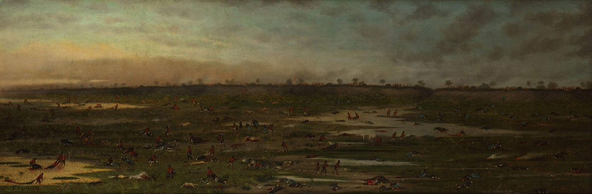
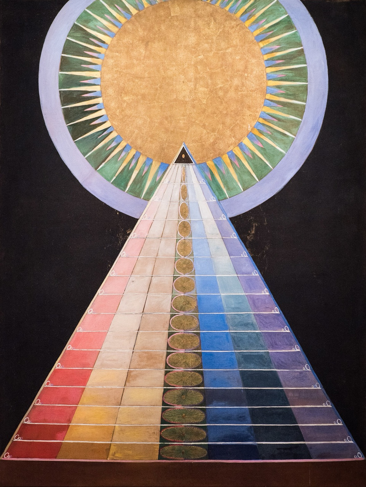
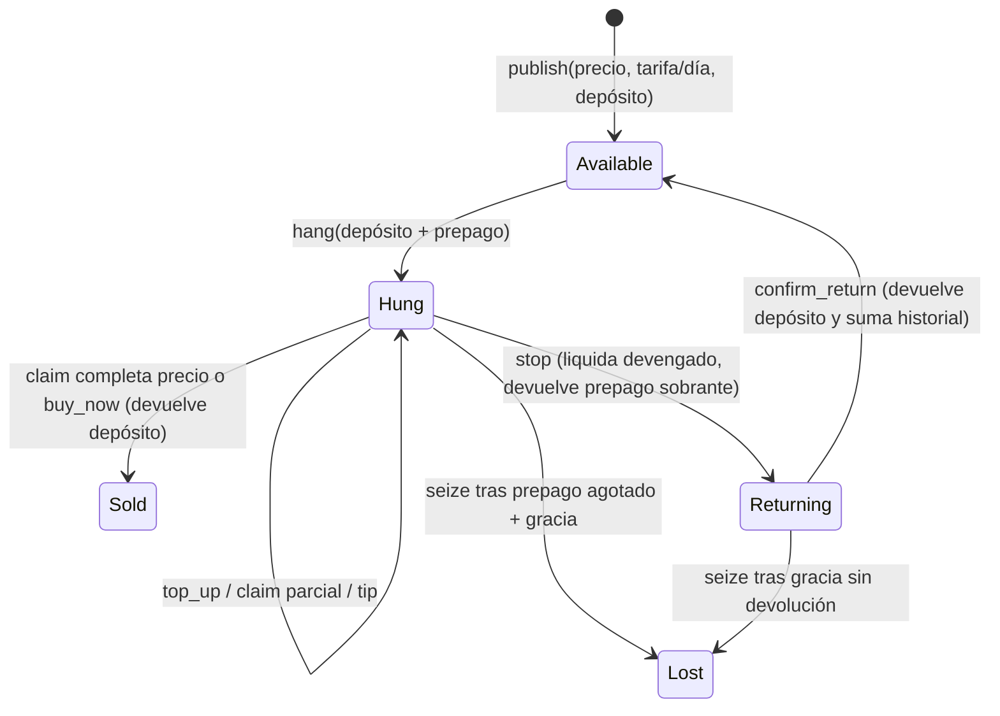

<div align="center">


<br />

[](https://muro.asymmetric.com.ar/)
[](https://stellar.expert/explorer/testnet/contract/CD725Z7JTP3BP3SR455WKYJS3AQHHVU7HZALNQBESQ2YGMRYCORN3T2Y)
[](contracts/muro/src/lib.rs)

</div>

---

## Qué es Muro

**Muro** conecta a artistas visuales con bares, bodegas, cafés y hoteles mediante un alquiler diario en cuotas sobre **Stellar Soroban**: mientras la obra cuelga en la pared, el local paga un alquiler por día que se descuenta automáticamente del precio de venta, respaldado por un depósito en garantía y un currículum público e inmutable de exposiciones.

> **Eje FLAT 2026 — Arte y Territorio:** pensado para artistas visuales de **Mendoza** y el **NEA** (y los espacios gastronómicos y culturales de su ciudad) cuya obra hoy decora paredes "por visibilidad", sin contrato ni trazabilidad. Si sacás el eje del arte en territorio concreto, el contrato pierde su razón de ser: el alquiler, la cartela QR y el historial existen para sostener el circuito de obra física local.

<div align="center">

|  |  |  |
| :---: | :---: | :---: |
| **Un bar aux Folies-Bergère** (1882)<br/><sub>Édouard Manet · *Obra #0 en demo*</sub> | **Después de la batalla de Curupaytí** (1893)<br/><sub>Cándido López · *Obra #1 en demo*</sub> | **Retablo n.º 1, Grupo X** (1915)<br/><sub>Hilma af Klint · *Obra #4 en demo*</sub> |

<sub>Obras de dominio público tomadas de [Wikimedia Commons](https://commons.wikimedia.org) para el catálogo de demostración.</sub>

</div>

---

## Cómo funciona

1. **El artista publica la obra** (`publish`) fijando tres valores: **precio de venta**, **alquiler por día** y **depósito en garantía**, más un identificador corto (`meta`). La obra queda disponible en taller.
2. **El espacio la cuelga** (`hang`) depositando la garantía y prepagando días de alquiler. El contrato custodia exactamente `deposit + prepaid` sin intervención de la plataforma.
3. **Cada día es una cuota del precio:** el alquiler se devenga por segundo contra el reloj de la red. Cualquiera puede liquidar lo devengado (`claim`): los fondos van directo al artista y reducen el saldo pendiente para comprar la obra.
4. **Se queda o vuelve:**
   - **Compra automática o anticipada (`claim` / `buy_now`):** cuando lo acumulado iguala el precio (o el espacio abona la diferencia), la titularidad on-chain pasa al espacio y el contrato le devuelve el depósito y el prepago sobrante.
   - **Devolución limpia (`stop` → `confirm_return`):** el espacio frena el alquiler, recupera el prepago no consumido y devuelve el cuadro; cuando el artista confirma la recepción, el depósito regresa al espacio y la exposición queda registrada en el currículum de la obra.
   - **Incumplimiento (`seize`):** si vence el prepago (o la devolución) y transcurre el plazo de gracia sin retorno ni recarga (`top_up`), el artista ejecuta el depósito.
   - **Cartela QR en la pared (`tip`):** cualquier visitante escanea la cartela impresa junto al cuadro, ve cuánto lleva cobrado en vivo y deja una propina directa al artista sin instalar extensiones (en Testnet, con cuenta de invitado fondeada por Friendbot).



---

## Por qué blockchain y por qué Stellar

Si una base de datos tradicional alcanzara, usar blockchain solo agregaría fricción. En Muro, las tres piezas centrales del acuerdo dependen de reglas públicas y micropagos continuos:

| Requisito de Muro | Qué resuelve Stellar Soroban |
|---|---|
| **Liquidación diaria viable** | Las transacciones cuestan una fracción de centavo: cobrar alquileres chicos por día (y propinas de QR) es económicamente inviable con tarjetas o transferencias bancarias. |
| **Custodia sin plataforma intermediaria** | `deposit + prepaid` quedan retenidos por código inmutable (sin admin ni *upgrade* y 0 % de comisión). Ni nosotros ni el espacio podemos frenar un `claim` ya devengado. |
| **Currículum de exposiciones confiable** | Cada exposición registrada costó dinero real on-chain. Nadie puede editar ni borrar dónde estuvo colgada la obra. |
| **Datos livianos on-chain** | Solo montos, estados, historial (tope de 100 registros por obra) y `meta` (hasta 512 bytes) viven en cadena. Imágenes y catálogos se sirven off-chain. |

---

## Ecosistema Stellar y consulta a Raven

### Componentes existentes utilizados (y qué descartamos con criterio)

- **SAC / SEP-41 (`soroban_sdk::token::Client`):** estándar nativo de activos en Stellar (XLM nativo en Testnet; USDC en producción).
- **Freighter (`@stellar/freighter-api`) + Modo Invitado Testnet:** firma estándar con verificación explícita de passphrase de Testnet, más cuenta efímera en navegador con Friendbot para pruebas sin fricción.
- **Soroban RPC (`@stellar/stellar-sdk`) & Stellar Expert:** lectura de estado sin servidor intermedio y auditoría pública de contratos, eventos y hashes.
- **Por qué no Trustless Work:** Trustless Work libera pagos por hitos discretos y cobra **0,3 % por transacción**. Muro necesita devengo continuo por tiempo acreditado a una compra, con un depósito atado al mismo estado: un esquema por hitos no representa un alquiler diario y un fee porcentual fijo encarece las micro-liquidaciones diarias.

### Consulta a Stellar Raven (28 de noviembre de 2026)

Consultamos [Stellar Raven Playground](https://raven.stellar.org/playground) para verificar antecedentes del ecosistema (incluidos proyectos financiados por el *Stellar Community Fund*) y evitar reinventar soluciones existentes:

> *«Muro combina alquiler diario acreditable a compra, garantía y registro de exposiciones para arte físico en espacios comerciales. Existen antecedentes en propiedad condicional de NFT, tokenización de arte y streaming de pagos; no identificamos ninguno que combine estas funciones del mismo modo».*

- **Antecedentes contrastados:** **Plutus** (SCF, marcado inactivo — propiedad condicional de NFT), **Neftwerk** (tokenización de arte), **Kunst21** (SCF, inactivo — crowdinvesting) y **ART Club** (SCF — financiación de creadores). Ninguno resuelve alquiler diario en comercios acreditado a compra + depósito + CV de exposiciones.
- **Componentes evaluados:** **SStream / Zentra** (streaming temporal, repos con última actividad en 2024, sin depósito ni compra), **Mica** (escrow inmobiliario), **Litemint / OpenZeppelin Contracts** (NFT/royalties: por recomendación explícita de Raven, no agregamos NFT en el MVP porque un token no prueba entrega física ni transferencia legal) y **Passkeys / StreamingFast** como camino para producción. Ver análisis completo en [`docs/MURO.md#consulta-a-stellar-raven`](docs/MURO.md#consulta-a-stellar-raven).

### Diseño del contrato (`contracts/muro/src/lib.rs`)

- **Storage y TTL:** configuración global en `instance()`; obras, leases, historial (máximo 100) y propinas en claves `persistent()` por obra con `extend_ttl` en cada mutación (`touch`).
- **Autorizaciones y eventos:** `require_auth()` y validación de rol (`artist` / `venue` / `from`) en todas las operaciones privilegiadas; `claim` es permisiva por diseño (siempre transfiere al artista). Emite 9 eventos tipados (`Published`, `Hung`, `ToppedUp`, `Claimed`, `Sold`, `Stopped`, `Returned`, `Seized`, `Tipped`).
- **Seguridad y pruebas:** **41 unit/regression tests** (`cargo test`) y una auditoría independiente documentada en [`docs/AUDITORIA.md`](docs/AUDITORIA.md) (incluyendo corrección H1 de redondeo en `settle`, tope `1e18` stroops, depósito obligatorio `> 0`, cabeceras CSP estrictas y correcciones de auditoría en `5cd0a20`).

---

## Beneficios y modelo de negocio

| Actor | Qué gana con Muro |
|---|---|
| **Artista** | Sale del taller sin regalar obra "por visibilidad": cobra por día, tiene garantía económica si no la devuelven, suma CV verificable y recibe propinas directas por QR. |
| **Bar / Bodega / Hotel** | Renueva su pared con obra original sin desembolsar el total de entrada; si el público y el lugar se enamoran del cuadro, cada alquiler ya pagado contó como cuota. |
| **Visitante** | Escanea la cartela física junto al cuadro, conoce su historia y apoya al artista al instante sin instalar apps ni intermediarios. |

**Modelo de negocio:** en el MVP el contrato cobra **0 % de comisión**. Para producción se proyecta una comisión acotada (**1–2 %**) únicamente sobre compras completadas, servicios físicos para locales (impresión de cartelas, logística y seguro) y curaduría verificada para espacios.

---

## Validación con alguien de afuera

Entrevistamos a **Laura Zapata**, artista visual con taller propio en **Resistencia (Chaco)**, enviándole el prototipo vivo en Testnet ([`muro.asymmetric.com.ar`](https://muro.asymmetric.com.ar/)) y 4 preguntas concretas (audio completo de 2 min 24 s transcripto en [`docs/validacion-laura-zapata.md`](docs/validacion-laura-zapata.md)).

> *«La usaría así como está... Es una manera de ir pagándola [para quien expone] cuando quizás no cuenta con todo el dinero junto y le gusta. Solamente tendría que quedar claro que al dueño del bar o la bodega realmente le guste la obra, que no sea solo para darnos una mano».* — **Laura Zapata**

**Qué aprendimos y ajustamos:**
1. **Problema validado en taller:** confirmó que muchas obras terminadas quedan guardadas sin mostrarse por falta de reglas y circuito claros.
2. **Alquiler como cuota entendido al instante:** lo percibió justo para ambas partes e incluso valioso como financiamiento en cuotas para el espacio.
3. **Claridad en el acuerdo ("favor" vs. elección curatorial):** incorporamos la explicación explícita de que el espacio elige la obra porque la quiere en su pared y que devolverla (`stop`) no es un conflicto — recupera su depósito y el artista cobra los días expuestos.
4. **Siguiente paso:** contrastar disposición de pago diario con dueños de bares/bodegas y probar el flujo presencial de escaneo de cartela.

---

## Evidencia verificable en Stellar Testnet

- **App desplegada en vivo:** [https://muro.asymmetric.com.ar/](https://muro.asymmetric.com.ar/)
- **Contrato Demo (`1 día = 60 s`, gracia `1 día`):** [`CD725Z7JTP3BP3SR455WKYJS3AQHHVU7HZALNQBESQ2YGMRYCORN3T2Y`](https://stellar.expert/explorer/testnet/contract/CD725Z7JTP3BP3SR455WKYJS3AQHHVU7HZALNQBESQ2YGMRYCORN3T2Y)
- **Contrato Real (`1 día = 24 h`, gracia `7 días`):** [`CDUIZ5SRWZTZUBLZJIBLFNVKPQZMRUNNFJRZF346CGDLHVWNPNFVGDGI`](https://stellar.expert/explorer/testnet/contract/CDUIZ5SRWZTZUBLZJIBLFNVKPQZMRUNNFJRZF346CGDLHVWNPNFVGDGI)
- **Token (XLM nativo, SAC):** [`CDLZFC3SYJYDZT7K67VZ75HPJVIEUVNIXF47ZG2FB2RMQQVU2HHGCYSC`](https://stellar.expert/explorer/testnet/contract/CDLZFC3SYJYDZT7K67VZ75HPJVIEUVNIXF47ZG2FB2RMQQVU2HHGCYSC)

Muestra de transacciones reales ejecutadas y verificables en Stellar Expert (ver las **12 transacciones completas** en [`docs/evidencia-testnet.md`](docs/evidencia-testnet.md)):

| Operación | Qué ocurrió en Testnet | Transacción verificable |
|---|---|---|
| `publish` | Artista publica *Un bar aux Folies-Bergère* (`#0`, 300 XLM, 3 XLM/día, depósito 40) | [`5ceaac97…`](https://stellar.expert/explorer/testnet/tx/5ceaac971e65d3c951b8fd75bd7ca0956646fec00d2120cbf8717fe5e110a15f) |
| `hang` | Espacio cuelga obra `#0` por 120 días (depósito 40 XLM + 360 XLM prepago) | [`040333bd…`](https://stellar.expert/explorer/testnet/tx/040333bd25a6ceb081c5fa258e3ded5b108c975c3fc0db4588d92a370ec52457) |
| `stop` | Espacio devuelve obra `#1`: liquida devengado y recupera prepago sobrante | [`eae4e15c…`](https://stellar.expert/explorer/testnet/tx/eae4e15c1b1698e2993c1309d1c795d1f4827f1e705ca7e7b6a0755bb1a68709) |
| `confirm_return` | Artista confirma devolución de `#1`: depósito vuelve al espacio y suma historial | [`3f95bf73…`](https://stellar.expert/explorer/testnet/tx/3f95bf73604c145bcf466efa54ec8cccbad66402c195baa6a42e11c54f4449a3) |
| `claim` | Visitante ejecuta `claim` sobre `#0`: paga lo devengado al artista | [`43b4375a…`](https://stellar.expert/explorer/testnet/tx/43b4375a0983bc13c493e04b61a4c6031be0e8017a0c6355de6b6da241b9329f) |
| `tip` | Visitante envía propina de 5 XLM al artista desde la cartela de `#0` | [`67e12f32…`](https://stellar.expert/explorer/testnet/tx/67e12f32a96d7458f1d1c9ae45507639f8bfc528c7e3cf8f984556d7c4e67232) |

---

## Cómo correrlo localmente

```bash
# 1. Contrato Soroban (Rust + Stellar CLI)
cargo test
stellar contract build

# 2. Frontend web (Vite + React + TypeScript)
cd web && npm install && npm run dev      # http://localhost:5173
npm run build                              # build estático en web/dist

# 3. Despliegue y demo en Stellar Testnet (opcional)
scripts/reset-demo.sh                      # despliega instancias, siembra obras y regenera evidencia
```

### Estructura del repositorio

```text
contracts/muro/         Contrato Soroban en Rust (lib.rs) y 41 tests (test.rs)
web/                    App React + Vite + TypeScript (root directory para Vercel)
scripts/                Scripts de despliegue, seed y regeneración de evidencia en Testnet
docs/                   Documentación, especificación, auditoría, validación y evidencia
.agents/skills/         Skills oficiales de desarrollo en Stellar (enlazadas en .claude/skills/)
```

---

## Documentación y checklist de entrega (FLAT Stellar 2026)

| Documento | Contenido |
|---|---|
| [`docs/MURO.md`](docs/MURO.md) | Documento integral de producto, diseño, Raven, validación y guion del video |
| [`docs/specs/contrato-muro.md`](docs/specs/contrato-muro.md) | Especificación técnica del contrato (`Status`, `Lease`, `Record`, eventos y reglas) |
| [`docs/AUDITORIA.md`](docs/AUDITORIA.md) | Auditoría independiente de seguridad, correcciones y riesgos conocidos |
| [`docs/evidencia-testnet.md`](docs/evidencia-testnet.md) | Registro completo de los 12 hashes en Testnet y enlaces a Stellar Expert |
| [`docs/validacion-laura-zapata.md`](docs/validacion-laura-zapata.md) | Entrevista externa con Laura Zapata (Resistencia, Chaco) y transcripción |

### Checklist en Stellar Apex ([stellarapex.org](https://stellarapex.org/))

- [x] Alcance, modelo de negocio y justificación de **por qué blockchain** definidos
- [x] Uso de componentes existentes de Stellar (`SAC/SEP-41`, `Freighter`, `Stellar Expert`) y justificación frente a `Trustless Work`
- [x] App funcionando en **Stellar Testnet** ([muro.asymmetric.com.ar](https://muro.asymmetric.com.ar/))
- [x] Hashes de transacciones verificables en **Stellar Expert** ([evidencia completa](docs/evidencia-testnet.md))
- [x] README completo con arquitectura, beneficios, validación y guía de ejecución
- [x] Validación con usuario externo del equipo ([entrevista a Laura Zapata](docs/validacion-laura-zapata.md))
- [x] Consulta a **Stellar Raven** documentada ([ver análisis](docs/MURO.md#consulta-a-stellar-raven))
- [ ] **Video público de 2 a 3 minutos**
- [ ] Proyecto publicado en **"FLAT Stellar 2026"** y marcado como **público** en Apex antes del sábado 28 · 23:59

---

<div align="center">
<sub><em>«Antes de existir en el mundo, existió en la imaginación de alguien.»</em> — Hackathon FLAT 2026 · BAF × Stellar</sub>
</div>
